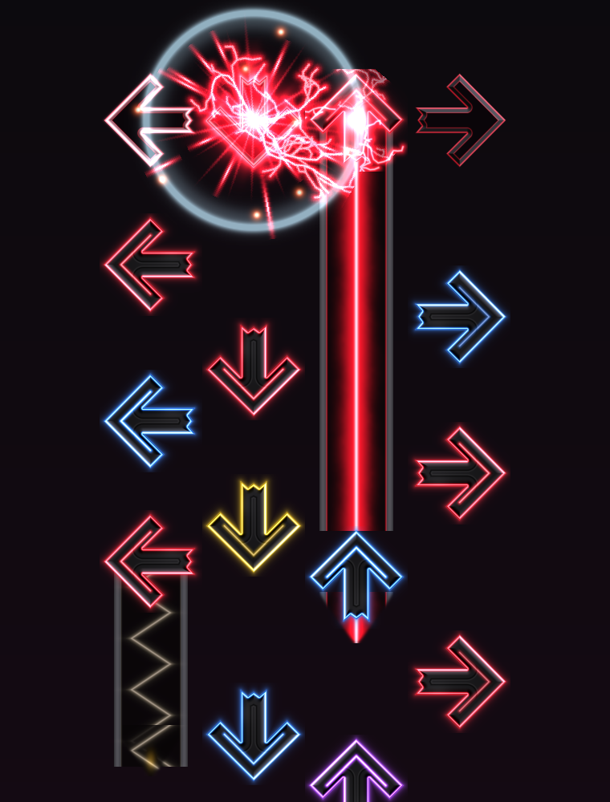
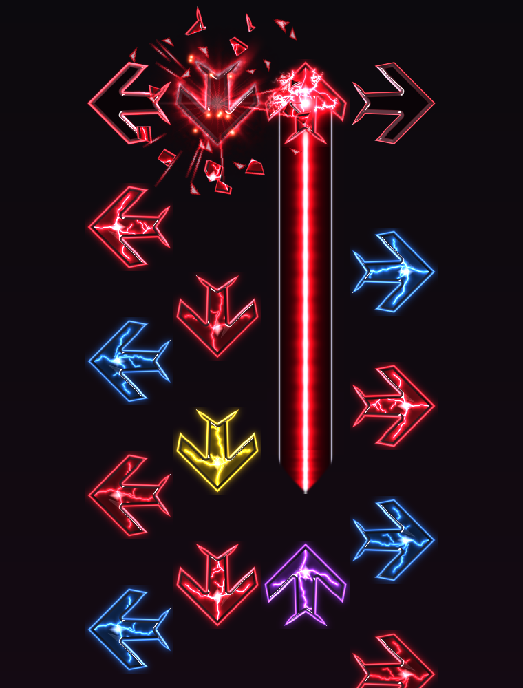
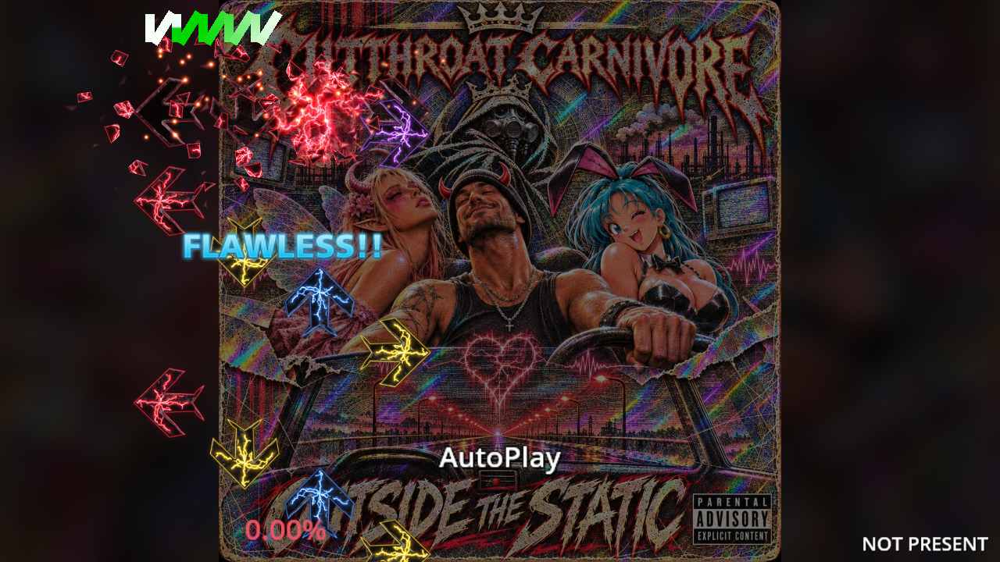
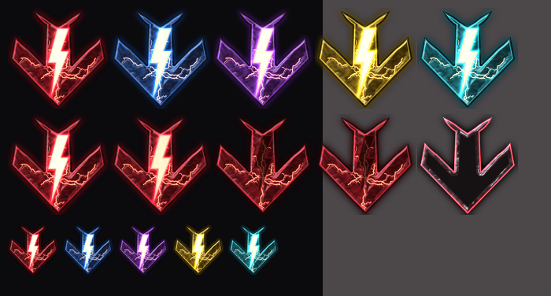
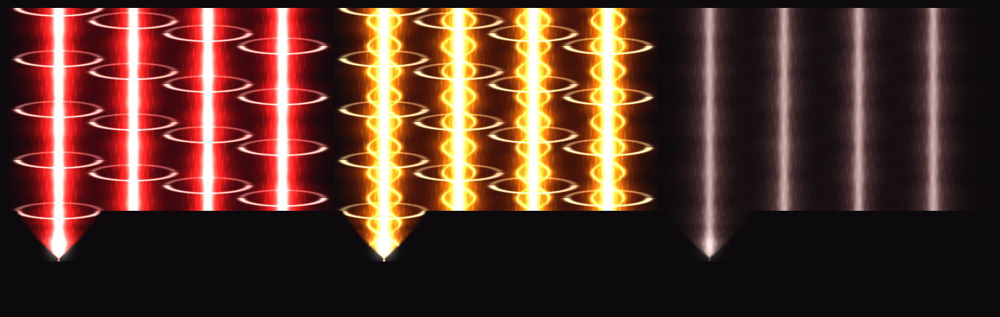

# Dev log — how this noteskin came together

All times Pacific.

### 11/22/2026 04:06 AM — The brief
"Dark Knight meets Darth Vader, powerful particle effects, red electricity,
Dragon Ball-style power." Start from the feel of the skin CC already plays
(sparkle + explosion on hit), but make it his own.

Finding: the skin he'd been using (Starspark) forbids modified versions, so
nothing from it could be reused. Decision: build 100% original, keeping only the
*feel* (layered hit explosions, sparkle particles, beat-flashing receptors).

### v0.1 — Neon outline mock (rejected)

Neon outlines + lightning burst + shockwave ring. CC: *"Not like something made
in MS Paint."* → needs real shading and real menace.

### v0.2 — Glossy armour, lightning-filled faces, shatter (kept as a variation)

Proper 3D shading, barbed blade wings, devil horns. CC asked for: no ring, the arrow
must **shatter into particles**, arrows easier to see, and **lightning inside each
arrow flashing to the BPM**. All added and verified in-game with no errors and no
performance cost vs the stock "cel" skin.
CC's verdict in-game: *"plastic and silly rather than menacing."* Kept as
`cutthroat-carnivore` (glossy) for anyone who likes it.

### v0.3 — Forged (kept as a variation)

Hammered, scratched dark iron, cracks with energy burning through. Tried serrated
saw-tooth wings — they broke the arrow shape at speed, so the clean barbed outline
stayed. Receptors got a dark backing so they never vanish on busy song art.

### v0.4 — Inferno (current beta)
Inspiration: Peter Lawrence's solid, filled skins. CC's direction:
- **Filled, solid, visible — but menacing, not a toy.**
- **One clear beat indicator:** a lightning bolt that flashes on and off exactly on
  the BPM.
- **Shatter into smaller pieces, more profound.**
- **Holds like a Marvel vs. Capcom hyper beam / Kamehameha, with rings.**

Also borrowed one idea from Peter's credits: overlapping explosions, so every
column has 3 rotating burst slots and fast streams stack shatters.

**Next:** community feedback (see `FEEDBACK.md`), then the release candidate goes into
NotITGmania Cutthroat Carnivore Edition as the official skin.
