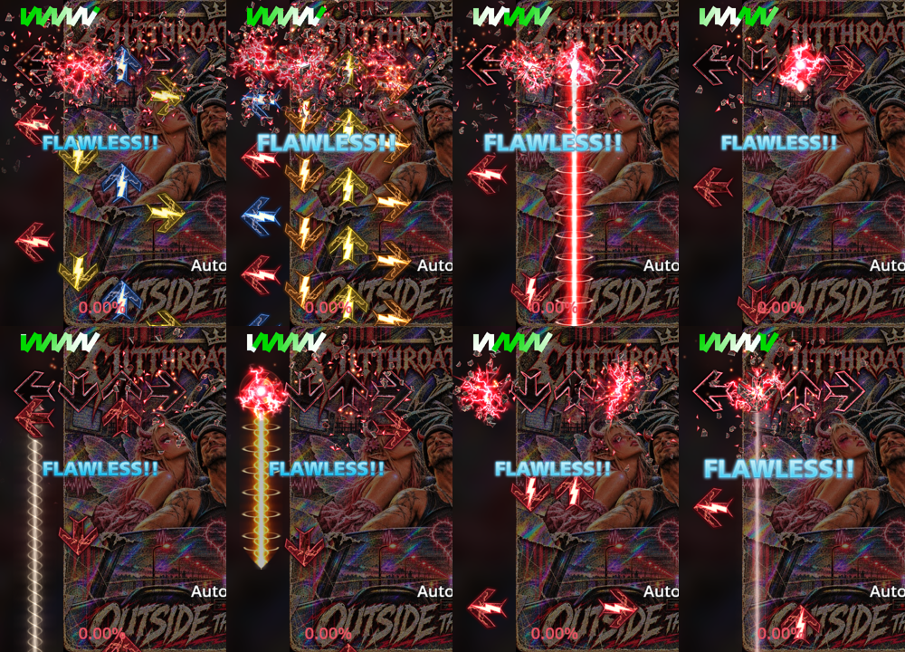

# Cutthroat Carnivore Noteskin — Workshop (Beta)

The official Cutthroat Carnivore noteskin for ITGmania, built in the open.
This folder is the whole process: every version so far, the code that draws
every image, the test setup, and how to give feedback that actually ships.

**Current beta: v0.4.0 "Inferno" (Build 1, 11/22/2026)**

## What it does
- **Solid forged-metal arrows** in rhythm colours (4th red, 8th blue, 12th purple,
  16th gold, 24th pink, 32nd orange, 48th cyan, 64th green, 192nd steel), heavy black
  outline, burning cracks.
- **Beat bolt:** a lightning bolt on every arrow snaps ON for the first half of each
  beat and OFF for the second half, locked to the song's BPM (BPM changes included).
- **Shatter:** a hit breaks the arrow into 28 iron fragments that blast out, tumble and
  fall, with a debris storm, sparks, embers, smoke, flash and red lightning. Better
  judgments hit harder. Fast streams stack shatters instead of cutting them off.
- **Hyper-beam holds:** white-hot core, crimson energy, rings rushing down the beam on
  the beat, and an energy ball charging at the receptor. Rolls are a gold helix beam.
- Receptors flash on the beat and flare a ki aura when you step. Mines are
  reactor orbs.

## Try it
1. Download the newest zip from **Releases** on GitHub (or the `builds` folder on Google Drive).
2. Unzip it into your ITGmania `NoteSkins/dance/` folder
   (Mac: `~/Library/Application Support/ITGmania/NoteSkins/dance/`).
3. Restart ITGmania → Player Options → NoteSkin → `cutthroat-carnivore-inferno`
   (rhythm colours) or `cutthroat-carnivore-inferno-cycle` (cycling colours).

## How it's made (honest version)
- Every image is **drawn by code** — math (distance fields, lighting, procedural
  noise and lightning). No AI image generator, and no art taken from anyone else's
  noteskin.
- The code was written by **Claude (Anthropic's AI)** working under Cutthroat
  Carnivore's direction: he calls the look, tests it, and approves or rejects every
  version. The whole back-and-forth is in `DEVLOG.md`.
- Engine side is plain StepMania 5 / ITGmania noteskin Lua (`source/skin-lua/`).
- Look inspiration: Peter Lawrence's public-domain noteskins
  (https://github.com/Pete-Lawrence/Peters-Noteskins) — idea only, none of their files.

## Folder map
| Folder | What's inside |
|---|---|
| `builds/` | Installable zips of every version (both colour modes each) |
| `previews/` | Mockups and in-game screenshots from each version |
| `source/scripts/` | Python that draws every texture and assembles the skin |
| `source/skin-lua/` | The noteskin Lua (router, receptor, notes, explosions) |
| `source/test-lab/` | Autoplay test theme + test chart used to check every build |
| `DEVLOG.md` | How it evolved, what got rejected and why |
| `PATCH_NOTES.md` | What changed in each version |
| `FEEDBACK.md` | What to test, how to report, and the credits list |

## Use it however you want
Free to use, share, edit and remix — part of the Cutthroat Carnivore movement.
All we ask: tell Cutthroat Carnivore what you made so he can play it too.
