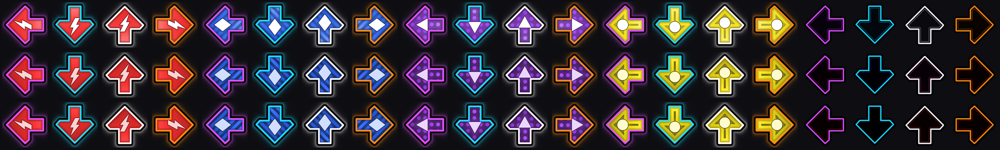
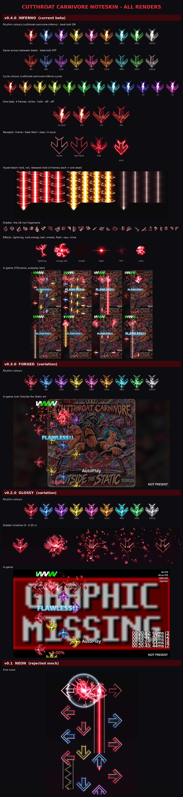

# Cutthroat Carnivore Noteskins — Official Release v1.0.0

The official Cutthroat Carnivore noteskins for ITGmania, built in the open.
Every variation, the code that draws every image, the test setup, and how to
give feedback that actually ships.

**Release: v1.0.0 (Build 2, 11/22/2026)** · Default: **Voltage**

## The official variations
Pick any of them in ITGmania: Player Options → NoteSkin.

| Name in the menu | Look |
|---|---|
| `cutthroat-carnivore-voltage` **(default)** | Bright, fully coloured arrows. Every rhythm has its own colour **and** its own face symbol (reads even if you're colour-blind), each direction its own edge colour, bolt strikes on the beat, shatter + lightning on the best hits, energy-beam holds |
| `cutthroat-carnivore-voltage-red` | Black arrows, red neon frame, rhythm-coloured face |
| `cutthroat-carnivore-voltage-pink` | Black arrows, pink neon frame, rhythm-coloured face |
| `cutthroat-carnivore-inferno` | Dark forged-metal arrows in rhythm colours, beat bolt ON/OFF every beat, shatter into 28 iron fragments, Kamehameha hyper-beam holds |
| `cutthroat-carnivore-inferno-cycle` | Inferno with cycling colours |
| `cutthroat-carnivore-forged` | Hammered dark iron with energy cracks |
| `cutthroat-carnivore-forged-cycle` | Forged with cycling colours |
| `cutthroat-carnivore` | Glossy armour with lightning-filled faces |
| `cutthroat-carnivore-cycle` | Glossy with cycling colours |

Rhythm colours (Voltage symbols in brackets): 4th red (bolt), 8th blue (diamond),
12th purple (triangle), 16th yellow (circle), 24th pink (hollow triangle),
32nd orange (ring), 48th cyan (hollow diamond), 64th green (small ring), 192nd grey (dot).

## Install
1. Download `CC-Noteskins-v1.0.0-All-Variations.zip` from **Releases** on GitHub
   (or the Google Drive folder).
2. Unzip it into your ITGmania `NoteSkins/dance/` folder
   (Mac: `~/Library/Application Support/ITGmania/NoteSkins/dance/`).
3. Restart ITGmania → Player Options → NoteSkin. The Cutthroat Carnivore theme
   uses Voltage by default.

## How it's made (honest version)
- Every image is **drawn by code** — math (distance fields, lighting, procedural
  noise and lightning). No AI image generator, no art taken from anyone else's skin.
- The code was written by **Claude (Anthropic's AI)** under Cutthroat Carnivore's
  direction: he calls the look, plays it, and approves or rejects every version.
  Voltage came from the NotITGmania Cutthroat Carnivore Edition build; Inferno,
  Forged and Glossy from the noteskin workshop. The full story is in `DEVLOG.md`.
- Engine side is plain StepMania 5 / ITGmania noteskin Lua.
- Look inspiration: Peter Lawrence's public-domain noteskins
  (https://github.com/Pete-Lawrence/Peters-Noteskins) — idea only, none of their files.

## Folder map
| Folder | What's inside |
|---|---|
| `previews/` | Render sheet, mockups and in-game screenshots |
| `source/voltage/` | Voltage generator (`gen_voltage.py`) + its Lua |
| `source/scripts/` | Inferno / Forged / Glossy generators + assembler |
| `source/skin-lua/` | Inferno / Forged / Glossy noteskin Lua |
| `source/test-lab/` | Autoplay test theme + test chart used to check every build |
| `DEVLOG.md` · `PATCH_NOTES.md` · `FEEDBACK.md` | History, changes, how to help + credits |

## Use it however you want
Free to use, share, edit and remix — part of the Cutthroat Carnivore movement.
All we ask: tell Cutthroat Carnivore what you made so he can play it too.
